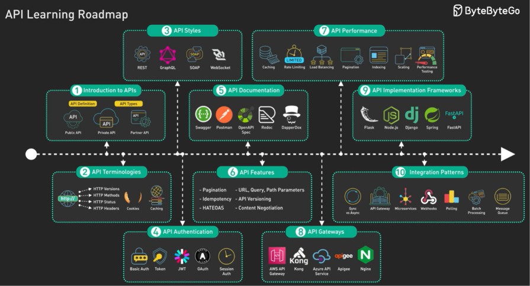

###  API

1. What an API is

An API (Application Programming Interface) is a set of rules that allows different software systems to communicate with each other.

2. Types of APIs

Public APIs: Open to external developers.
Private APIs: Used internally within an organization.
Partner APIs: Shared with specific business partners.

3. Major API styles

REST: Most common, resource-based and stateless.
GraphQL: Lets clients request exactly the data they need.
gRPC: High-performance communication using Protocol Buffers and HTTP/2.
SOAP: XML-based protocol often found in legacy enterprise systems.
WebSockets: Persistent, two-way real-time communication.

4. REST API fundamentals

Common HTTP methods:
GET = retrieve data
POST = create data
PUT = update data
DELETE = remove data
HTTP status codes communicate request outcomes.
Headers and cookies provide context and state information.

5. API security and authentication

Basic Authentication (older approach)
Token-based Authentication
JWT (JSON Web Tokens)
OAuth (widely used standard for authorization)
Session-based Authentication

6. Documentation and testing

OpenAPI/Swagger help define API contracts.
Postman is commonly used for testing and collaboration.
Good documentation is essential for API adoption and correct implementation.

7. Important API features

Pagination for large datasets
Parameters (path, query, body)
Idempotency for safe retries
Versioning to avoid breaking existing integrations

8. Performance and scalability

Caching
Rate limiting
Load balancing
Database indexing
Vertical and horizontal scaling
Performance testing

9. API gateways

Centralized entry points that handle:
Routing
Authentication
Rate limiting
Monitoring
Examples mentioned include AWS API Gateway, Kong, and Apigee.

10. Popular API frameworks

Express.js (Node.js)
Spring Boot (Java)
Flask, Django, and FastAPI (Python)

11. Advanced integration patterns

Synchronous communication
Asynchronous communication
Webhooks
Batch processing
Message queues
One-sentence takeaway

